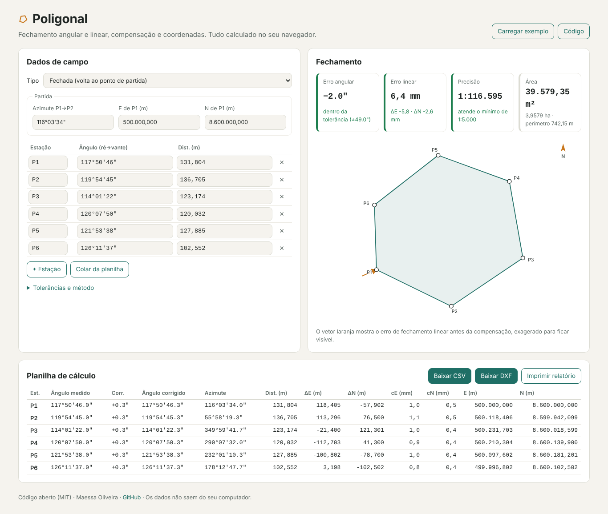

# Poligonal

[](https://github.com/maessa-oliveira/poligonal/actions/workflows/ci.yml)
[](https://maessa-oliveira.github.io/poligonal/)
[](LICENSE)

**Calculadora de poligonal topográfica no navegador.** Digite (ou cole da planilha) os ângulos e as
distâncias medidos em campo e veja na hora o fechamento angular e linear, se está dentro da
tolerância, a compensação, as coordenadas, a área e o desenho da poligonal.

👉 **[Abrir a calculadora](https://maessa-oliveira.github.io/poligonal/)**: já abre com um exemplo fictício.



> 🇬🇧 *Browser-based traverse calculator for land surveying: angular and linear misclosure, tolerance
> checks, Bowditch/transit adjustment, coordinates, area, CSV/DXF export and a printable report.*

## O que faz

- **Poligonal fechada** (volta ao ponto de partida) e **enquadrada** (sai de um par de pontos
  conhecidos e chega em outro).
- **Fechamento angular**: soma dos ângulos × (n−2)·180° ou (n+2)·180° (detecta internos/externos),
  tolerância `T"·√n` configurável e correção distribuída igualmente.
- **Fechamento linear**: erro em E e N, erro total e **precisão relativa 1:N** comparada ao mínimo
  exigido (padrão 1:5.000).
- **Compensação** pelo método de **Bowditch** (proporcional às distâncias) ou do **trânsito**
  (proporcional às projeções).
- **Coordenadas** de todos os vértices, **área** (fórmula de Gauss) e perímetro.
- Aceita ângulos como `117°50'46"`, `117 50 46`, `117-50-46` ou `117.5046` (formato GGG.MMSS) e
  vírgula decimal.
- **Abre o arquivo da estação total (.M21)**: lê as visadas de ré (`*R`) e vante (`*V`) de cada
  estação, monta a sequência da poligonal, calcula o ângulo horário e usa a **média das distâncias
  de ida e volta**; irradiações são ignoradas e leituras repetidas são promediadas.
- **Cola direto do Excel** ou abre CSV/TXT (Estação ; Ângulo ; Distância).
- **Fator de escala K** nas distâncias (ex.: fator UTM combinado).
- Exporta **CSV** (abre no Excel em português), **DXF** (poligonal, vértices e rótulos) e um
  **relatório completo** (resumo, croqui e planilha, pronto para salvar em PDF).
- **Privacidade**: tudo roda no navegador; nenhum dado sai do seu computador.

## Como o cálculo é feito

```
ângulos medidos ─► erro angular = Σα − (n∓2)·180° ─► correção −e/n em cada ângulo
                                                    │
azimute de partida ─► Az(i) = Az(i−1) + α(i) − 180° ◄┘
                                                    │
distâncias ─► ΔE = d·sen Az, ΔN = d·cos Az ─► erro linear (ΣΔE, ΣΔN) ─► precisão 1:Σd/e
                                                    │
                       compensação (Bowditch ou trânsito) ─► coordenadas, área, DXF
```

- `src/poligonal.js`: todo o cálculo, **sem dependência de navegador** (testado em Node).
- `src/relatorio.js`: croqui em SVG e relatório em HTML.
- `src/app.js`: interface e exportações.

## Testes

```bash
npm install
npm test          # 17 testes do cálculo (casos com resposta conhecida)
npm run test:e2e  # abre a página num Chromium real e confere cálculo, edição e downloads
```

Os testes geram poligonais a partir de coordenadas conhecidas e conferem que o cálculo devolve as
mesmas coordenadas, que a compensação fecha exatamente e que os erros são detectados.

## Licença

MIT. Os dados de exemplo são fictícios.
